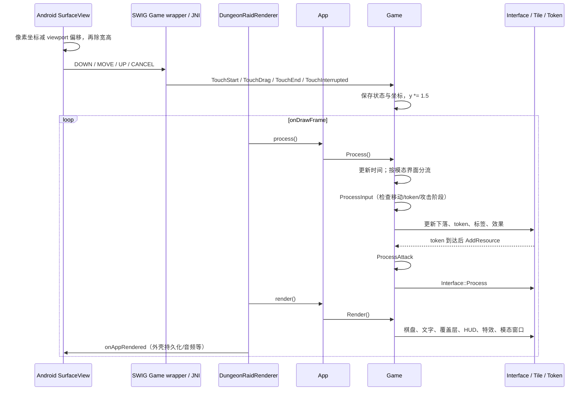

# 00 原生模型与执行入口（T01）

## 阅读约定与证据地址

本文与 01、02 以本仓库二进制及反编译结果为规格来源。字段名是根据读写用途起的工作名，不声称恢复了原 C++ 成员名；`+0x…` 是相对所属对象的**字节偏移**，不是 TypeScript 布局要求。函数 `@0x…` 默认是 `ghidra/functions.tsv` 地址；`disasm @…` 是 `disasm-thumb.txt` 的 ELF 虚拟地址。二者相差 `0x10000`，例如 `RandUnitF` 分别为 `0x67610`、`0x57610`。字符串证据一律是文件偏移，不能直接套用这个差值。[证据: functions.tsv 的 RandUnitF 行；disasm 的 `_Z9RandUnitFRj`；ELF 节头/动态符号表，提取过程见 tools/extract-enums.py]

伪 C 的 `undefined/void` 返回类型、丢失的 `this`/浮点参数、`__DT_SYMTAB + Game*` 表达式均可能是类型恢复问题。已复核的例子：`GetNearestUnmatchedTile` 实际返回行号或 -1；`GetPoison` 实际返回移位前的第一个毒槽；`RandUnitF` 实际返回浮点数。不能据伪 C 的函数签名直接生成绑定。[证据: disasm @0x14510–0x1455e、@0x52b0c–0x52b3e、@0x57610–0x57644]

## 类与主要字段

### Game：局内状态与执行协调者

`App::init` 分配 `0x15e74` 字节的 Game。构造器嵌入棋盘、字体、界面、菜单、存档与十个职业对象；同时维护资源、选中链、动画和声音/成就队列。[证据: App::init @0x24404；Game::Game @0x28c8c]

| Game 偏移 | 工作含义 | 证据 |
| --- | --- | --- |
| `+0 / +4` | 上次时间 / 本帧时间差（float） | Game::Game @0x28c8c；Game::Process @0x339ac；UpdateTime @0x258e0 |
| `+0xc` | 已结算回合数，新局 0 | InitNewGame @0x2d7a4；EndOfTurn @0x3289c 开头加 1 |
| `+0x20 / +0x24 / +0x28` | TouchState / 触摸 x / 触摸 y | TouchStart/Drag/End/Interrupted @0x2442c–0x24468 |
| `+0x2c / +0x1240 / +0x2454` | 三套 Font | Game::Game @0x28c8c |
| `+0x3668 / +0x4cec` | Arrow / Interface | 同上 |
| `+0x5f74` | 可开始输入的新回合标记；MatchTiles 清零 | MatchTiles @0x31bcc；ProcessInput @0x330c0 |
| `+0x5fc4 / +0x5fc8` | 格宽 / 拖线方向阈值 | Start @0x260ac；ProcessTileSelection @0x2c8dc |
| `+0x5fcc` | Tile[6][6]，行跨度 `0xea0`，格跨度 `0x270` | Game::Game @0x28c8c；InitNewGame @0x2d7a4 |
| `+0xb78c / +0xb794` | 有序选择链 / 箭头跨越的忽略格集合 | ProcessTileSelection @0x2c8dc；MatchTiles @0x31bcc |
| `+0xb7ac / +0xb7b4` | 移动中 Tile 列表 / 36 个中心坐标 | MoveMatchedTiles @0x2fd7c；CalculateTilePositions @0x25f64 |
| `+0xb8d4 / +0xb8e0` | Token 容器 / 活跃范围；容器后还有粒子与标签 | AddToken @0x2a934；Process @0x339ac |
| `+0xbc5c` | 敌人攻击表现状态 0…8 | ProcessAttack @0x311b8；ProcessInput @0x330c0 |
| `+0xc158 / +0xc15c / +0xc160` | 当前 HP / 基础 HP 上限 / 装备与属性附加上限 | InitNewGame @0x2d7a4；UpdateStats @0x26c94；AddResource @0x32210 |
| `+0xc164 / +0xc168` | 当前护甲 / 最大护甲 | UpdateStats @0x26c94；AddResource @0x32210 |
| `+0xc170 / +0xc174 / +0xc178` | XP / 升级点 UP / 金币条余数 | AddResource @0x32210；SerialiseState @0x265f4 |
| `+0xc17c / +0xc180 / +0xc184` | 每剑武器伤害 W / 基础伤害 / 附加基础伤害 | UpdateStats @0x26c94；ProcessTileSelection @0x2c8dc |
| `+0xc188 / +0xc18c` | 每点格挡的护甲破损判定阈值 / 对敌破甲阈值 | UpdateStats @0x26c94；ProcessAttack @0x311b8；AttackSkull @0x2f630 |
| `+0xc190,+0xc194 / +0xc198,+0xc19c / +0xc1a0,+0xc1a4` | XP、金币、UP 的小数累积器与每 token 附加率 | AddResource @0x32210 |
| `+0xc1a8,+0xc1ac … +0xc1c0,+0xc1c4` | STR/DEX/VIT/LUK 的基础值与装备附加值，间隔 8 | InitNewGame @0x2d7a4；UpdateStats @0x26c94 |
| `+0xc1c8,+0xc1cc / +0xc1d0,+0xc1d4` | 每药水治疗基础/附加；每盾修甲基础/附加 | AddResource @0x32210；Skill::Initialise(StatType) @0x606a4 |
| `+0xc1d8…+0xc1f4` | 金币/药水/XP/盾的额外 token 概率，基础和附加各 4 字节 | MatchTile @0x2ac40；InitNewGame @0x2d7a4 |
| `+0xc20c / +0xc210 / +0xc214 / +0xc218` | 局内等级 / 已跨过的 XP / 金币 / UP 整百累计 | AddResource @0x32210；SerialiseState @0x265f4 |
| `+0xc21c / +0xc220 / +0xc228 / +0xc22c / +0xc230` | 武器毒 / 吸血百分比 / 反伤 / 削弱攻击 / 每回合再生 | UpdateStats @0x26c94；AttackSkull @0x2f630；ProcessAttack @0x311b8；EndOfTurn @0x3289c |
| `+0xc234…+0xc237` | 本轮剑/盾/药水/金币双倍；后四字节是下一轮标记 | EndOfTurn @0x3289c；ProcessTileSelection @0x2c8dc；AddResource @0x32210 |
| `+0xc23c / +0xc240 / +0xc244` | 链总伤害 / 已计入基础伤害 / 敌人合计攻击 | ProcessInput @0x330c0；InitialiseFlares @0x2a548 |
| `+0xc248…+0xc258` | 五个 Item 指针，依次武器、头盔、铠甲、盾、饰品 | InitNewGame @0x2d7a4；ItemType.java:7 起 |
| `+0xc25c` | Item 槽位地址组成的 vector（元素是 Item**） | Game::Game @0x28c8c；UpdateStats @0x26c94 的双重解引用 |
| `+0xc358…+0xc364 / +0xc368` | 四个 Skill 指针 / 已选技能数 | Start @0x260ac；EndOfTurn @0x3289c |
| `+0xc36c…+0xc37c` | 一次收集各基本类型的计数 | MatchTiles @0x31bcc；MatchTile @0x2ac40 |
| `+0xc380 / +0xc381` | 重填过滤开启 / 改为排除剑（否则排除骷髅） | RandomiseTile @0x2d584；TeleportEnemy @0x29ad8 |
| `+0x14300 / +0x14314` | 局内 / 职业 GameState 缓冲，容量 2048 / 1024 | Game::Game @0x28c8c |
| `+0x14328 / +0x14330 / +0x14335` | 难度 / 挑战模式值 / 是否挑战 | NewGame @0x2de68；StartChallenge @0x2de10；SerialiseState @0x265f4 |
| `+0x14338 / +0x1433c` | 特殊敌人倒计时 / 允许重置倒计时 | IsTimeToPromote @0x250b0；SetTimeToPromotion @0x2985c |
| `+0x1433d / +0x1433e` | 新骷髅 1 HP / 新格强制金币；`+0x1433f/40` 为下一轮 | RandomiseTile @0x2d584；EndOfTurn @0x3289c |
| `+0x14d84 / +0x14d88` | 本轮敌方毒攻击 / 玩家持续毒 | InitialiseFlares @0x2a548；ProcessAttack @0x311b8 |
| `+0x14d90 / +0x14da0 / +0x14da4` | 本次 AttackSkull 成功击杀计数 / 距奖杯特殊击杀计数 / 本局已出奖杯数 | AttackSkull @0x2f630；MatchTile @0x2ac40 |
| `+0x14dac / +0x15cd4` | 十个 CharacterClass，步长 `0x184` / 当前职业索引 | Game::Game @0x28c8c |
| `+0x15cec…+0x15cee` | Last Stand 当前/后继/延迟保护标记 | CheckEndGame @0x2f960；EndOfTurn @0x3289c |
| `+0x15e28 / +0x15e71` | 挑战棋盘 y 偏移 / Sprint 100 回合结束标记 | CalculateTilePositions @0x25f64；EndOfTurn @0x3289c |

关键方法：`Start` 建立界面和四个技能对象；`InitNewGame` 重置局内状态；`ProcessInput → MatchTiles → MoveMatchedTiles → ProcessAttack → EndOfTurn` 推进一轮；`Process` 协调每帧工作；`Render` 分层绘制；`SerialiseState/DeserialiseState1/2` 管理存档。[证据: 上表方法及 functions.tsv @0x2733c、@0x2785c]

### Tile：格子与敌人共用的实体

| Tile 偏移 | 含义 | 证据 |
| --- | --- | --- |
| `+0…+0x73` | Quad 基类；`+0x54/58` 中心坐标 | Tile::Tile @0x63f44；PositionTile @0x24560 |
| `+0x74 / +0x78 / +0x7c` | Game* / 列 x / 行 y | CalculateTilePositions @0x25f64；GenerateStats @0x63098 |
| `+0x80 / +0x84` | 格宽 / 半宽 | CalculateTilePositions @0x25f64 |
| `+0x88 / +0x89 / +0x8a` | 已标记消除 / 已选中 / 本轮新补入 | MatchTile @0x2ac40；ProcessTileSelection @0x2c8dc；MoveMatchedTiles @0x2fd7c |
| `+0x8c/90 / +0x94` | 下落目标坐标 / 正在移动 | PositionTile @0x24560 |
| `+0xa0 / +0xa4` | TileType / SpecialTileType | SetType @0x64ef8；SetSpecialType @0x65004 |
| `+0xa8 / +0xac / +0xb0 / +0xb4` | 敌人攻击 / 防御 / 当前 HP / 最大 HP | GenerateStats @0x63098；Serialise @0x62c28 |
| `+0x23c` | 0…7 外观变体 | SetType @0x64ef8 |
| `+0x240…+0x244` | 魔法剑、箭、法力药、酸药、爆炸药标记 | SetType @0x64ef8；Serialise @0x62c28；Token::InitialiseFromTile @0x653d0 |
| `+0x248 / +0x24c / +0x250` | 三回合毒槽（int） | AddPoison @0x62ad4；GetPoison @0x62b0c，反汇编 @0x52b0c |
| `+0x25c / +0x260` | EnemyType / 能力倒计时或巫妖命匣状态 | GenerateStats @0x63098；ActivateAbility @0x64c78 |
| `+0x264 / +0x265 / +0x266 / +0x267 / +0x268` | 本轮能力已执行 / 冰冻 / 燃烧 / 燃烧不伤玩家 / 燃烧伤害 | ActivateAbility @0x64c78；SetFlameVisibility @0x62de8；EndOfTurn @0x3289c |
| `+0x26c / +0x26d / +0x26e` | 破损 / 技能晋升的特殊敌人 / 命匣首轮延迟 | MakeBroken @0x64a80；Promote @0x64e3c；AttackSkull @0x2f630 |

`Serialise` 对药水/剑/盾/特殊格写不同变体字节，随后写冰火状态；骷髅再写攻防血、敌人编号、倒计时、晋升标记、毒槽。TileType 本身由 Game 在 18 个字节中打包 36 个半字节，所以不能单独把 Tile::Serialise 当成完整格子格式。[证据: Game::SerialiseState @0x265f4；Tile::Serialise @0x62c28]

### 装备、升级、技能、职业

| 类 | 职责、主要字段与关键方法 | 证据 |
| --- | --- | --- |
| Upgrade | 可选择奖励的显示基类；`+0` 虚表，`+4…+0x53` 四顶点数据，`+0x54/58` 图标参数，`+0x5c` 名称缓冲（由派生类写），`+0x7c` Game*（由派生类赋值）；RenderIcon、SetIcon | Upgrade::Upgrade @0x672d0；Item::Item @0x50e0c；Skill::Initialise @0x606a4 |
| Item | 五装备槽中的物品，派生 Upgrade；`+0x80` ItemType，`+0x84` 外观/名称索引，`+0x88/8c/90` 序列化元数据（确切语义待 T02）；`+0x94…+0xe0` 20 项升级整数，`+0xe4/+0xfc` 字符串，`+0x114` 起显示属性对；Initialise、GenerateName、GenerateStats、MakeStats、Serialise、ReduceStat | Item::Item @0x51620；Serialise @0x4bb90；UpdateStats @0x26c94 |
| ItemUpgrade | 单项物品升级选项，派生 Upgrade；`+0x80` 升级种类，用于 `g_upgradeNames[index*17]`；Initialise、GetRandomStat、GetDescription | ItemUpgrade::ItemUpgrade @0x51cc0；Initialise @0x523c8；GetDescription @0x51740 |
| Skill | 主动技能或升级时的属性奖励，派生 Upgrade；`+0x80` 激活标记，`+0x84` 类型，`+0x88` 序列化元数据，`+0x8c` 冷却所需回合，`+0x90` 已恢复回合，`+0x94` Label，`+0x1e4…+0x200` 属性奖励；Activate、Deactivate、Initialise、Serialise | Skill::Skill @0x60b60；Serialise @0x6009c；EndOfTurn @0x3289c；Initialise @0x606a4 |
| CharacterClass | 职业长期成长与局内种族/优缺点配置；`+0` Game*，`+4` ClassType，`+8` RaceType，`+0x10…1c / +0x20…2c` 优点/缺点槽，`+0x30/3c/48` vector，`+0x54` 职业等级（字节），`+0x58/5c` 局数/击杀累计，`+0x60/64/68` 三档最高分，`+0x16c` 集合；Initialise、HavePerk、HaveFlaw、GetMortalEnemyType、LevelUp、SerialiseGameState/FullState | Initialise @0x36524 初始化段；构造 @0x35b90；SerialiseGameState @0x361ac；SerialiseFullState @0x36494；CheckEndGame @0x2f960 |

### 存档和界面

| 类 | 职责、主要字段与关键方法 | 证据 |
| --- | --- | --- |
| App | 持有 `+0` Game*；init/process/render/done | App::init @0x24404；process @0x243dc；render @0x243d0 |
| GameState | 字节缓冲对象，**不是游戏阶段枚举**；`+0` 容量、`+4` 数据指针、`+8` 写入长度、`+0xc` dirty、`+0x10` 读游标；WriteChar/WriteInteger/ReadChar/ReadInteger，整数低字节先写 | 构造 @0x47420；WriteChar @0x47378；WriteInteger @0x4738c；ReadChar @0x473bc |
| Menu | 菜单绘制基类；`+0` 虚表、`+4` 按钮顶点数组（构造参数×80 字节）；派生菜单各有状态，不能假定所有界面都继承 Menu | Menu::Menu @0x5458c；functions.tsv 中 Menu 方法组 |
| Interface | HUD、四条资源显示、菜单与技能按钮；`+0` 起 Quads，`+0xd98/d9c` HP/上限，`+0xda0/da4/da8` XP/UP/金币，`+0xdc0/dc4/dc8/dcc` 每剑伤害/当前甲/最大甲/基础攻击；`+0xdf0` FoldoutMenu、`+0xf08` GameMenu、`+0xf9c` StatsMenu、`+0x1144` Game*、`+0x114c` Tooltip；ShowMenu、UpdateSkills、Process、Render | 构造 @0x4a414；Game::AddResource @0x32210（HUD 的 Game 绝对偏移减 `0x4cec`） |
| ScoreScreen | 六类本地分数和显示页；`+0` Game*、`+4` 可见、`+0x1ec` 起记录区，类跨度 `0x230`，记录跨度 `0x38`；`+0xf0c` 起六个记录数，`+0xf24/f28` 当前记录定位，`+0xf2c` 1024 字节 GameState，`+0xf44` 起 dirty；AddScore、CreatePage、Show、SerialiseState | 构造 @0x5e6f8；SerialiseState @0x5cb34 |
| Token | 资源飞行动画兼待结算事件；`+0x74` Interface*、`+0x78` TileType、`+0x7c` token 变体、`+0x98` 技能索引/伤害载荷、`+0x9c` 敌方接收者（不入玩家资源）；InitialiseFromTile、Process | InitialiseFromTile @0x653d0；Game::Process @0x339ac；ThrowSkull @0x2eeb0 |

其余原生应用类完整名称清单：`Arrow、ClassScreen、FoldoutMenu、Font、GLcolour4、GLfloat2、GameMenu、GameOverScreen、HelpMenu、IntroScreen、Label、MainMenu、ModeScreen、NameScreen、Particles、Quad、QuadStrip、ScorePage、SimpleLabel、StatsMenu、Tooltip、UnlockMenu`。它们分别承担线条、菜单/页面、字体/文本、向量/颜色、粒子和矩形绘制；本卡只登记，未完整恢复这些表现类的成员布局。`std` 与 `__cxxabiv1` 是容器/运行库命名空间，不列为游戏模型。[证据: functions.tsv 去重后的类限定名；Game::Game @0x28c8c 的子对象构造；Game::Render @0x25924 的绘制调用]

## 主循环与触摸

图中顺序依据 Java `DungeonRaidRenderer.java:39–54`、`DungeonRaidSurfaceView.java:74–100`、wrapper `Game.java:50–63`、`App::process/render @0x243dc/0x243d0`、`Game::Process @0x339ac`、`Game::Render @0x25924`。原生把回合逻辑分散在动画到达事件中；移植时需要保留事件先后与菜单暂停点，不能简单按帧调用纯规则的“下一轮”。[证据: Process @0x339ac 中 AddResource 后检查菜单并提前 return；ProcessInput @0x330c0 的移动列表/token/flaring 守卫]

## 枚举数据的使用边界

`data/enums.json` 覆盖 wrappers 的 **20 个枚举类、315 项**，包括任务列举之外的 `Achievement、Sound、Texture`。`ScorePage、GameState` 是普通 wrapper 类，不是枚举。每项保留 wrapper 行号；JNI 常量另存对应原生函数路径。`displayName/description` 是带来源及字符串文件偏移的对象，未定位的填 null，不从枚举英文拼造显示名。[证据: tools/check-enums.mjs 对 swigValues/声明逐项检查；各 Java 文件]

需要特别区分：`TileType.TILE_TYPE_COUNT=5` 在 `MatchTile` 参数中充当“按原格类型收集”，`TILE_NONE=7` 充当“不发奖励”；`GameMode.MODE_CLASSIC=3` 不能取代“非挑战”布尔；`PERK_NONE/FLAW_NONE/SKILL_NONE=255`。原生枚举中出现但 Java 未导出的 MenuType、DungeonRaidTokenType 等，不混入“全部 wrappers 枚举”计数。[证据: MatchTile @0x2ac40；SerialiseState @0x265f4；JNI getters @0x2336c、0x23370、0x233b0]

## 未决问题

- **O1：技能边界冲突。** Java `SkillType.java:47` 的 `SKILL_COUNT=40`，原生 `g_skillNames/g_skillDescriptions` 各有 42 槽；`Skill::Activate @0x60210` 的 40/41 分支调用 Shock/Awe，属性奖励从 42 开始（Initialise @0x606a4）。JSON 保留 wrapper 值，同时放入 `nativeOnlySkillSlots`，不把 Shock 当作 COUNT 的显示名。已查 getter、Activate、ELF 表长；T02 必须明确原生 42 技能与 Java 40 技能的使用边界。
- **O2：显示文本并非每个枚举都有。** 已检查固定宽度表、Get*Name/Description、strings；TileType、ItemType、DamageType、TouchState、RandType、ScoreType、SpecialTileType、Achievement 未证明一对一显示表，不能拿物品名“Shield”代替格子或装备种类名。Sound/Texture 的原生资源名保存在 resourceName，不冒充界面显示文本；Race 的能力/宿敌文本单独保存；Stat 的描述由函数动态拼装，未伪造静态文本。
- **O3：非核心布局。** 表中保留的 Item/Skill 元数据、CharacterClass 三个 vector 的全部元素语义及其余 UI 类偏移尚未逐项闭合；已查构造与序列化入口，完整装备/职业/计分/存档由 T02 继续。本文不是完整可回写的 C++ ABI 定义。
- **O4：动画事件的逻辑顺序。** Process 的遍历顺序已提取；Token 到达先后取决于速度、目标和帧差。纯引擎如何复现多类型奖励/伤害同时飞行的边界，需要对 Token::Process 和技能触发路径继续核验（02 的未决项有具体影响）。
