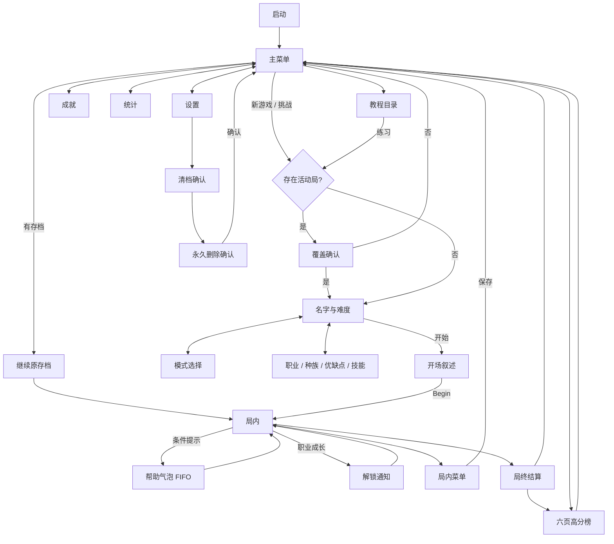

# U03 局外屏幕交付报告

日期：2026-10-16。已阅读仓库 AGENTS.md、U03任务卡、P3规划、10–12规格及U02/U04/T06/T07报告。局外流程已接入现有Canvas应用，规则引擎未改动；公开构建通过。**这是可运行的Web移植交付，不声明尚未恢复的原生矩形或同帧帮助竞争次序已做到逐像素/逐帧一致。**

## 完成清单

| 内容 | 实现与边界 |
| --- | --- |
| 主菜单 | 使用A02 `main.background`；继续/新游戏/挑战/教程/高分榜/声音的已证命中矩形；无活动存档禁用继续、无记录禁用高分榜；启动.51s、主菜单进.5s/出.3s。新增本地成就、统计、设置入口 |
| 新游戏 | 已有活动局先确认；名字/模式/难度/职业配置；Classic、Sprint、Pretzel；四难度；Intro后进入局内。开始时传入`NewGame.character`，未另写规则 |
| 名字 | Web原生输入框；16个Unicode码点，过滤控制字符；空名榜单显示“无名冒险者”。原生证据为16个单字节键盘字符，扩展中文是移植差异 |
| 职业配置 | 四个原生标签：职业、种族、优点与缺点、技能；优点/缺点有独立子页；职业等级、完成局数、最佳分；真实锁定图标；默认档案只有冒险者可用 |
| 编辑门槛 | 使用`isPerkSlotUnlocked`、`canChangeRace`、`replacementSkillsAllowed`、`validateConfiguration`、`getSkillPool`、`isSkillUnlocked`；首个优缺点槽/首个职业技能固定；全局种族/优缺点解锁另按原生查询实现；冒险者展示全局技能池，不伪造可替换槽 |
| 教程/帮助 | 主菜单23页帮助目录与练习入口；练习默认Easy并重置23位；普通新游戏关闭自动提示；自动帮助有持久化一次性位、FIFO、.2s进出、点气泡内部关闭；设置可重置 |
| Intro | 使用L01的61段中英故事，独立表现随机源选段；1秒淡入/淡出；Begin使用已证按下区域并播放start声18一次 |
| 高分榜 | 6页、每页10行，榜单和最新记录位置直接读档案；名字、回合、分数、四技能图标；Pretzel独立Avg/Max/Total三列；新记录金色高亮；箭头与真实拖动使用原生逐帧公式 |
| 成就 | 1..77本地列表，解锁/百分比/未解锁状态；45明确不可获得。无原生远端标题映射，使用去前缀后的稳定枚举标识，不编造标题或成就条件 |
| 解锁/统计 | `ClassLevelChanged`排队，规则动画结束后显示Unlock并播放12；主菜单显示各职业等级/局数/击杀/最佳分；U04局内装备属性屏保留 |
| 设置 | 中文默认、英文切换；音量0..100%步长10%；静音；Clock/Dimming/Smooth与局内菜单共享同一状态/存储键；重置提示；双确认清档 |
| 局终返回 | 保留U04逐项结算，在结算页增加高分榜入口；进入最近记录对应页；可直接返回主菜单；结算档案仍由GameSession原事务处理 |
| 禁止项 | 未运行npm install、未commit、未推送；未修改reverse、APK、art、fonts、data/i18n、src/audio或src/core |

## 实现位置与接口

- `ui/front-model.ts`：ScorePager逐帧模型、HelpQueue位集与队列、CharacterEditor门槛、名字限制、帮助几何。
- `ui/front-screens.ts`：局外屏幕与组合器；使用U04的Assets/I18n/GameAudio/ScreenStack及现有面板、文字渲染。
- `ui/app.ts`：装配、局内等待动画完成后接入帮助/Unlock、局终高分榜入口；`render_game_to_text`增加帮助位/当前提示、职业标签/配置、榜单页/offset、设置快照。
- `ui/session.ts`：新增`clearProfile()`；`onEvents(events, cosmetics)`附加已有只读表现样本，用于识别原生bonus提示，不增加规则随机抽样。回调仅记录通知，显示和声音等候局内timeline完成。
- `ui/cues.ts`：start声18从NewGame规则批移到Intro的Begin入口，避免提早播放及重复播放。
- `test/ui-u03.test.ts`：14项新增测试。`tools/u03-browser.mjs`、`tools/u03-smoke.mjs`为可复跑浏览器检查；`docs/tasks/U03.fixtures.ts`只用于测试，不被应用导入。
- 技能要求的进度文件位于`ui/U03.progress.md`，遵守任务卡可写范围。

## 屏幕流转



`Name`中的模式/职业页面为压栈返回，返回时保留名字与难度；名字DOM输入随栈顶隐藏/恢复，离开名字页移除。ESC关闭局外页面/帮助，局内ESC仍进入U04菜单。

## 原生证据与补齐矩形

| 结论 | 证据 |
| --- | --- |
| 模式返回 `(228,451,89,26)` | `ModeScreen::ModeScreen @0x550e8` AddQuad `(104,1)-(193,27)`、policy2；SetPosition右/下各`.009375*320=3px`；`QuadStrip::UpdateSize @0x5bbc4`固定尺寸计算 |
| 高分榜返回同上 | `ScoreScreen::ScoreScreen @0x5e6f8`相同UV/策略/边距 |
| 名字16字符 | `NameScreen::ProcessInput @0x57a10`：长度`+2c14 <0x10`；strncpy长度0x10；`Game+c208=0` |
| 帮助完整锚定 | `HelpMenu::Show @0x48190`：宽.98，x截断3，height=`16*n+41.6`；锚点240分上下，间隔20；局部文字x19.2、baseline32+16*n |
| Intro动态行位置/Begin | `Initialise @0x4b668`：RandI(0,0x3c,0)，scale.12；`Process @0x4b35c`：进入/退出1s，x∈(80,240)、y>425.6的新按下，QueueSound0x12 |
| Unlock动态尺寸 | `Show @0x66fc4`：字体line=.12*(lineHeight-base)/lineHeight*320，宽maxText+line+28，高n*line+1.5*line+iconHeight+28；中心(160,240)及右边界裁界；QueueSound0xc |
| 职业编辑 | `ClassScreen::Process @0x3a598`固定首槽、冒险者不可换种族；`Game::IsRaceUnlocked @0x248a0`、`IsPerkUnlocked @0x24dec`；T06里程碑API |
| 榜单逐帧翻页 | `ScoreScreen::Process @0x5dba8`：速度权重.4；offset=.7*offset+.3*target；2px阈值；速度±.1或距离±.5翻页；页边界0..5 |
| 普通新局/教程帮助差异 | `Game::NewGame @0x2de68`关闭帮助；`StartTutorial @0x2ddb0`难度0并开启/重置帮助；`UpdateHelpState @0x24fb0`同步开关；`Initialise @0x48348`消费位；`QueueHelp @0x48514`/`Process @0x483a4` FIFO |

已写回`data/ui-layout.json`和10号规格。92个元素的固定rect由39增至41，null由53减至51，其中14个有动态公式。修改限于数值、公式、证据和已证输入边沿；未把Web布局写作原生坐标。

仍保留null并采用移植布局的本卡元素：

- Name：名字、键盘、难度、职业、模式、开始、返回。
- Mode：Sprint/Pretzel按钮与说明（Classic作为Web统一选择项额外出现）。
- Class：四标签、职业/种族网格、优缺点槽/候选、技能槽/候选、说明、返回。
- Scores：行布局、标题、左右按钮。
- Intro/Unlock：动态文字、奖励与确认；补了公式但字体/图标依赖未闭合，仍无固定rect。
- U04遗留Stats和GameOver复合矩形没有虚构补齐。

上述构造器和MakePanel/MakeButton/UpdateClass/CreatePage/Show的伪C浮点参数、运行时度量未全部恢复；10号规格保留未决列表。

## 测试与截图

- `npm run check`：**23文件 / 682项通过**；其中U03新增14项。类型、枚举、数据引用检查通过，记录见`U03.check.log`。
- 额外输出既有14项整局模拟；13组最终hash与U04逐项一致，见`U03.hashes.json`、`U03.playthrough.log`。比较对象为既有移植，不冒充Android原版golden trace。
- `npx vite build --mode pages && node tools/check-dist.mjs`通过：9个构建产物与120个原版资源对比，无原版资源泄漏。见`U03.build.log`、`U03.dist-check.log`。
- `node tools/check-ui-spec.mjs`通过；null仍保留，结构检查不代表像素复原完成。见`U03.spec.log`。
- `develop-web-game`标准Playwright客户端已执行并实际打开截图检查；另以真实pointer驱动完整流程，`U03.browser.json`记录桌面与375×812手机两组零浏览器错误。
- 最终自然局：桌面Sprint/Hard第24回合敌攻死亡；手机Sprint/Hard第23回合敌攻死亡。两者均从空档案经教程、配置、开局、刷新继续、自然终局、查看新纪录、返回主菜单完成。没有通过改HP或强造GameOver完成自然局。
- 独立标注`fixture`的测试档案验证：职业7级、换人类、成对优缺点、替换技能，经NewGame实际得到一致配置；Pretzel满10条统计；真实水平拖动翻页；奖杯点击触发职业解锁overlay；覆盖确认取消；两次确认清档及刷新不能复活旧存档。
- `U03.smoke.json`补验桌面/手机真实touchscreen点击、设置与静音/音量持久化、局内Clock与设置共享、名字超长截断、重置帮助后继续显示气泡。
- 截图位于`U03.shots/`，共66张JPEG，连同状态JSON共2,285,264字节（约2.29MB），JPEG质量64，桌面1024×768与手机375×812成对；覆盖任务清单、中文/英文、锁定/解锁、教程、Intro、结算、成就45、双清档确认等。状态JSON保存屏幕/按钮与错误快照。图像已目视检查；发现并修复了Pretzel Total列截断。

浏览器复跑（使用已有Playwright，无依赖安装）：

```sh
npm run dev -- --host 127.0.0.1 --port 5313
node tools/u03-browser.mjs
node tools/u03-smoke.mjs
```

可以用`U03_URL`和`PLAYWRIGHT_MODULE`指定地址/现有模块。不要同时执行会重写`ui/generated/runtime.json`的Vite构建，以免开发服热重载打断浏览器测试。

## 清档语义

第二次确认后，以一个v2存储写入重置以下内容：活动对局、玩家名、职业等级和配置、局数/击杀/最佳分、成就进度、六页高分榜、新纪录标记、跨局奖杯间隔。清除内存状态/时间线/事件日志；删除v1旧对局和档案迁移键（若删除失败，v2空档案仍屏蔽旧键）；帮助位重置为全开。

保留：语言、音量、静音、Clock、Dimming、Smooth。写入失败时保留当前档案/对局并显示存储错误，不报告清除成功。之后的pagehide保存只会保存新的空状态。

## 已知移植差异与未决问题

1. 不实现OpenFeint、More Games、在线High Scores、Bonus Item等外部服务；本地成就独立入口不是旧服务兼容实现。
2. 使用原创图集和OFL字体；主菜单原生命中矩形保留，烘焙字改为字体。新增设置/成就/统计、Classic统一模式项使用移植布局。
3. 名字用原生DOM输入而非屏幕字母键盘。16限制按Unicode码点；不复刻原ASCII键盘的输入范围。为避免误丢存档，覆盖确认后仍直到按“开始”才替换活动局，取消名字页可保留原存档。
4. 原生Class四标签中的Perks & Flaws在Web中有两个子页；原生拖放编辑改成点槽位再选候选，技能池分页；门槛和配置值由证据/API约束。长技能/优缺点说明可进入详情。
5. 帮助在已完成规则动画后的安全点依次显示；原生`Initialise`同帧只让第一个提示竞争显示，`QueueHelp`另有文本FIFO。Web统一延迟队列以避免中断触摸/动画，因此提示顺序及与盘面锚点的同帧对应不声称精确复刻。教程前增加可反复阅读的目录；按练习进入原生语义的默认Easy新局/帮助重置。
6. Intro文字按Web字体换行；故事选择用独立表现随机源；原生最终交叉绘制层次没有逐帧对照。帮助音效31虽有资源但无QueueSound证据，保持不播放；start18与Unlock12按直接证据接入。
7. 成就展示名/说明无本地原版映射；列表保留可识别的枚举名。新UI用语（Settings、统计、配置说明、不可获得、清档等）是`ui/front-screens.ts`中的临时双语文本；未修改`data/i18n/`。未新增美术或字体资产。
8. 继承U04/T07边界：商店I1仍使用显式合成fixture策略；无合法连线盘面的原版救济规则仍未决；本卡没有修改这些规则或声称解决P6对照。
9. 验收是本地Chromium桌面和模拟移动视口/真实触摸事件。没有声称完成Android真机、软键盘各浏览器、无障碍或扬声器听感验收；公开静态构建可用，未部署/发布。

## 给U05的建议

- 收敛临时双语文本到L01目录，安排成就展示标题（清楚区分产品文案与原生证据），更新字体子集覆盖新增用语。
- 优先打磨Class页英文长名称/标签省略，给网格加入键盘焦点与屏幕阅读器镜像；确认小号原生确认按钮的触摸可达性。
- Android真机验证DOM名字输入时软键盘导致的视口变化、后台恢复、DPR和音频解锁；保留当前真实touch与存档回归。
- 继续恢复仍为null的Class/Name/ScorePage矩形；帮助同帧竞争与Intro交叉绘制对照应与P6证据一起推进，不把现有Web布局反写成原生规格。
- 公开发布前沿用`check-dist`；本卡未上传任何原版美术/音效。
